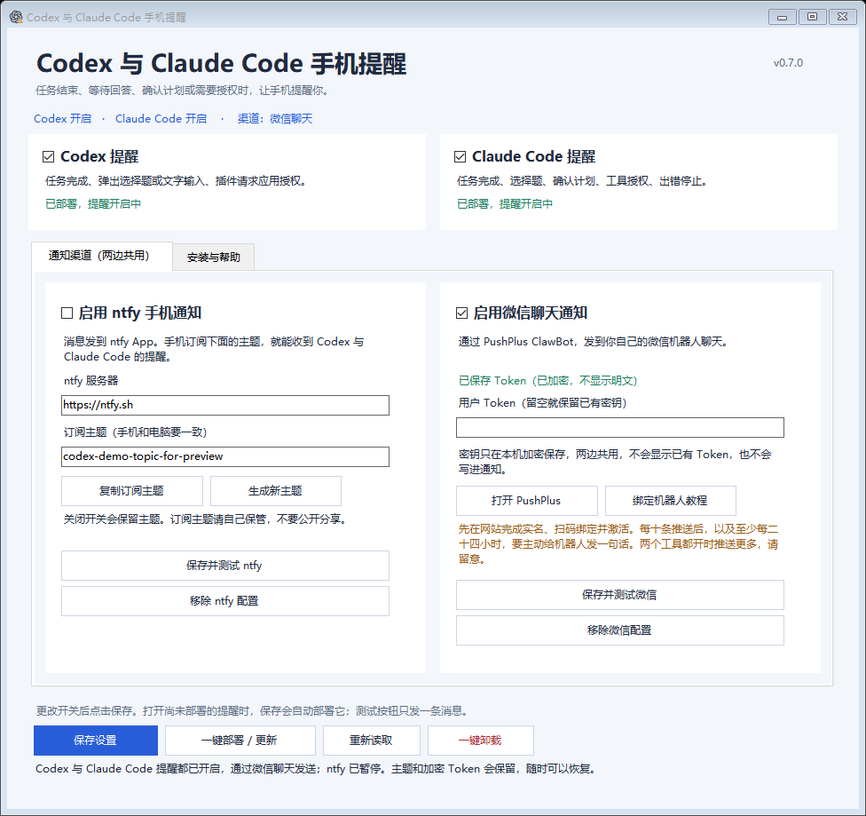

# 图形界面使用教程

[返回首页](../README.md) · [ntfy 手机设置](ntfy.md) · [微信机器人绑定](wechat.md)

**下载一个 Windows 软件，就能在窗口里设置 Codex 手机提醒，不必手动编辑配置文件。** 支持 Windows 10 / 11，不需要安装 Python、Node.js，也不需要管理员权限。

[下载 CodexPhoneNotifier.exe](https://github.com/xinmiao0303/codex-phone-notifier/releases/latest/download/CodexPhoneNotifier.exe)

## 第一次使用

1. 下载并双击 **CodexPhoneNotifier.exe**。
2. 勾选想使用的通知方式。可以只用 ntfy、只用微信，或两种都用。
3. 按下面的说明准备手机和填写设置，点击 **安装 / 更新通知工具**。
4. 切到 **安装与帮助**，点击 **打开钩子审查**。检查本工具的命令后信任，完成后关闭审查窗口。
5. 完整退出并重新打开 Codex，再分别测试手机通知和实际任务提醒。

安装可以自动完成电脑上的脚本、配置和钩子登记。**Codex 钩子信任、手机 App 的订阅、微信扫码实名和机器人激活，仍需要你自己完成。** 软件不能替你批准 Codex 的钩子。

钩子审查里，本工具命令指向 `codex-ntfy-notify.ps1`。完成提醒是后台 Stop，问题框是 PreToolUse，启动钩子只记录日志。本版本不登记普通审批提醒；应用访问授权通过独立 MCP 连接识别。升级会移除旧版的普通授权钩子。不要直接信任不认识的其他工具命令。

## ntfy 怎么设置？

- 开启 **启用 ntfy 手机通知**。
- 服务器默认是 `https://ntfy.sh`，也可以填写自己的服务器。
- 软件会为新用户准备随机主题，点击 **复制订阅主题**，在手机 ntfy App 订阅同一个主题。
- 点击 **保存并测试 ntfy**，检查手机是否收到。

已有配置会直接读取，不会自动更换主题。**生成新主题**需要你在手机订阅新主题，保存前不会改变已使用的主题。截图中的主题只是示例，请用软件给你生成的主题。

手机订阅、iPhone 显示名称和点击设置见 [ntfy 教程](ntfy.md)。主题请自己保管，不要公开分享。

## 微信怎么设置？

1. 点击 **打开 PushPlus**，用微信登录并完成实名认证。
2. 在网站个人中心绑定 **微信 ClawBot**，主动给机器人发一句话，再点“我已发送”，确认“已激活”。界面里的 **绑定机器人教程**可打开官方说明。
3. 复制 PushPlus 的 **用户 Token**，粘贴到软件密码框，开启 **启用微信聊天通知**。
4. 点击 **保存设置**，或 **保存并测试微信**。

Token 只在电脑上用 Windows DPAPI 加密保存，软件不回显已有密钥，也不把密钥写入进程参数、通知或日志。下次打开窗口看到“已保存 Token”，密码框仍是空的；**留空表示继续使用原密钥**。

测试请求被接受，不代表手机或手环已收到。测试时退出聊天页面，把微信放到后台并锁屏。微信和小米手环的设置见 [微信教程](wechat.md)。

每十条推送后、至少每二十四小时，需要主动给机器人发一句话。一个微信号只能绑定一个 ClawBot。[官方要求](https://www.pushplus.plus/doc/channel/clawbot.html)

## 开关、暂停和恢复

勾选或取消勾选两个渠道，然后点击 **保存设置**，下次自动提醒即生效。

| 选择 | 效果 |
| --- | --- |
| 只勾 ntfy | 自动提醒只发到 ntfy App |
| 只勾微信 | 自动提醒只发到微信 ClawBot 聊天 |
| 两个都勾 | 两种方式分别尝试发送 |
| 两个都不勾 | 暂停全部提醒，主题和加密 Token 仍保留 |

关闭渠道不用重启 Codex。测试按钮会先保存当前设置，再只发送到对应渠道；已经关闭的渠道不能直接测试，需要先勾选它。

**软件不用一直开着。** 保存后可以关闭窗口，Codex 的钩子会继续负责通知。

## 移除一个渠道，或者卸载整个工具

- **移除 ntfy 配置**：关闭 ntfy，移除本机的服务器、主题和认证设置。微信和共用钩子保留，不会删除手机 App 的订阅。
- **移除微信配置**：关闭微信，删除本机加密 Token 和发送状态。ntfy 和共用钩子保留，不会解除网站的机器人绑定。
- **安装与帮助 → 卸载通知工具**：移除本工具的钩子和脚本。默认保留主题与 Token；取消“卸载时保留”后，也会移除它们。

这些操作都有确认提示，并先备份原文件。不会删除其他 Codex 钩子、`config.toml` 或聊天记录。卸载共用钩子以后需要完整重启 Codex。

软件是便携程序，删除 `.exe` 本身不会停止已安装的自动提醒。想停止并清理，请先在界面里卸载通知工具，再删除软件。

## 更新和排查

0.6.0 保留主聊天完成过滤和同轮去重，为 Computer Use 的原生“允许 ChatGPT 使用某应用？”确认框增加手机提醒。普通命令权限和自动审批继续静默。

安装器先备份原配置，将 `[mcp_servers.node_repl]` 的 `command` / `args` 接到本机转发程序；同时为当前 Codex 目录登记 `CODEX_NODE_REPL_PATH` 用户环境设置，避免桌面启动时重建配置而失效。原插件程序、其他 MCP 服务、ntfy 和微信密钥保留。已有其他自定义运行程序时会提示并保留它。转发程序不批准或拒绝任何请求；等一秒仍未答复时才发送一次提醒，答复和取消会撤销尚未发出的通知。

**完整退出所有 Codex 窗口，再重新打开，才能加载原生授权连接。** 手机实测时，让尚未允许的应用授权弹窗停留几秒，确认收到“Codex 等待你授权”再选择。已经允许或快速答复的请求不应额外提醒。

卸载通知工具时恢复原 `node_repl` 启动配置和本工具登记的运行程序环境设置，保留安装后用户新增的其他设置。当前连接若仍占用辅助程序，会在重启 Codex 后停止使用。CLI 用户可用 `install.ps1 -NoApprovalReminder` 不安装此连接。未发现标准 `node_repl` 配置时不会改动其他 MCP 服务，完成和提问提醒仍能使用。

下载新的 `.exe`，点击 **安装 / 更新通知工具**。已有主题、标题、Token 和其他配置会保留；窗口里的未保存设置以本次保存为准。已使用微信的用户需先完成 ClawBot 绑定和激活。

**重新读取**会加载当前磁盘配置；有未保存修改时会先提示。**安装与帮助**可以打开配置目录、发送记录和中文教程。设置过 `CODEX_HOME` 时，软件使用对应目录；否则使用当前 Windows 用户的 `.codex`。

收不到时先分开看：ntfy 的订阅主题是否一致；微信 Token、实名、激活和最近一次主动互动是否有效；手机锁屏通知是否开启。手动测试能收到而自动提醒收不到，检查钩子信任和首次安装后的完整重启。

## 从源码构建

开发者可以在项目目录运行：

~~~powershell
powershell.exe -NoProfile -ExecutionPolicy Bypass -File .\build-desktop.ps1
powershell.exe -NoProfile -ExecutionPolicy Bypass -File .\tests\run-desktop.ps1
~~~

生成的 `dist/CodexPhoneNotifier.exe` 内置需要的 PowerShell 脚本，可以单独复制。界面使用 WinForms，构建使用 Windows .NET Framework 的 C# 编译器，不下载额外代码包。编译产物不进入源码仓库，发布在 GitHub Releases。
